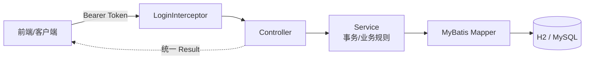
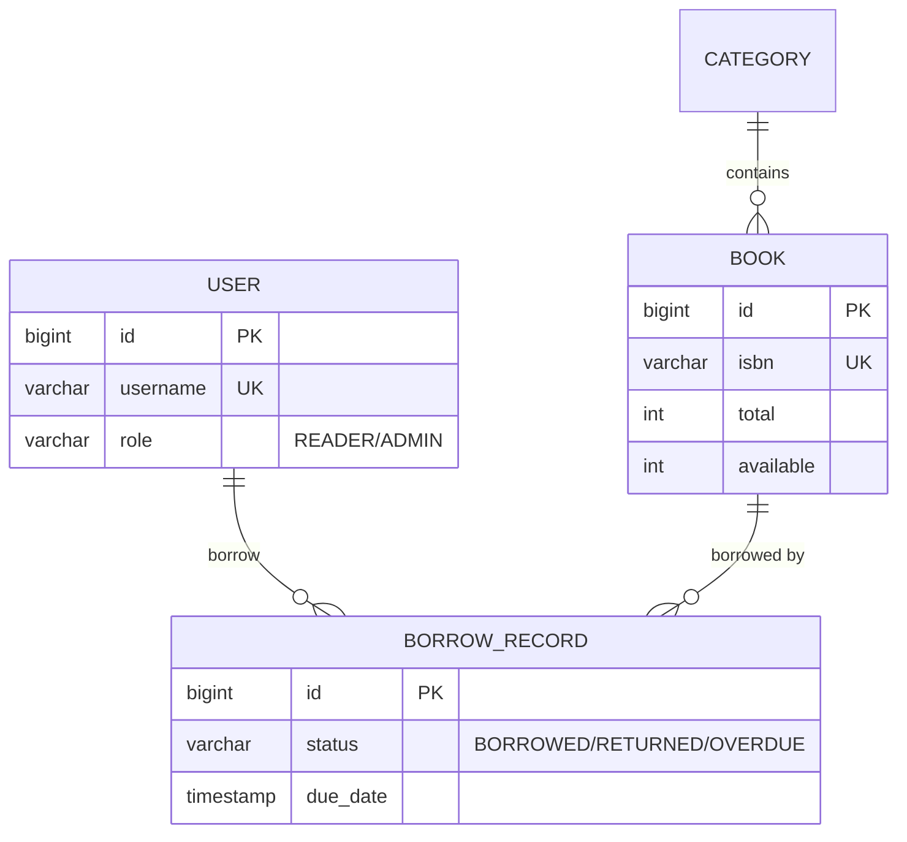

# 校园图书管理系统（后端）

> 面向校园图书馆场景的管理系统后端：图书检索、借还管理、逾期统计、权限分级。
> SpringBoot 3.5 + MyBatis + JWT，H2 内存库开箱即跑，可一键切换 MySQL。


## 功能特性

- **读者**：注册登录、图书检索（书名/作者/ISBN/分类 + 分页）、借书（限 5 本 / 30 天）、还书（自动判逾期）、借阅记录
- **管理员**：图书与分类增删改查、全部借阅记录、逾期未还统计
- **并发安全**：借书用原子 SQL 减库存（`WHERE available > 0`），并发下不超借
- **安全**：BCrypt 密码哈希、JWT 无状态认证、资源归属校验、统一异常返回

## 技术栈

| 层 | 技术 |
|---|---|
| 框架 | SpringBoot 3.5.16（内嵌 Tomcat） |
| ORM | MyBatis（注解 SQL） |
| 认证 | JWT (jjwt 0.12) |
| 加密 | BCrypt (spring-security-crypto) |
| 数据库 | H2（演示）/ MySQL 8（生产） |
| 校验 | Bean Validation |

## 架构



## 数据库设计



## 快速开始

```bash
# 需要 JDK 17+
mvn spring-boot:run
# 或运行已打包的 jar
java -jar target/campus-library-1.0.0.jar
```

服务地址 `http://localhost:8081`，H2 控制台 `http://localhost:8081/h2-console`（JDBC URL: `jdbc:h2:mem:library`）。

切换 MySQL：

```bash
# 先执行 src/main/resources/db/schema.sql 与 data.sql
mvn spring-boot:run -Dspring-boot.run.profiles=mysql
```

## 接口速览

| 方法 | 路径 | 说明 |
|---|---|---|
| POST | /api/auth/register · /login | 注册 / 登录（返回 JWT） |
| GET | /api/books | 分页检索（keyword/categoryId/page/size） |
| POST/PUT/DELETE | /api/books | 图书管理（管理员） |
| GET | /api/categories | 分类列表 |
| POST | /api/borrows?bookId= | 借书 |
| PUT | /api/borrows/{id}/return | 还书 |
| GET | /api/borrows/my | 我的借阅 |
| GET | /api/borrows/overdue-count | 逾期统计（管理员） |

演示账号：`admin / 123456`（管理员）、`reader1 / 123456`（读者）

```bash
curl -X POST http://localhost:8081/api/auth/login \
  -H "Content-Type: application/json" \
  -d '{"username":"admin","password":"123456"}'
```

## 项目结构

```
src/main/java/com/campus/library
├── common        # 统一返回体 / 业务异常 / 全局异常处理 / 分页
├── config        # 拦截器与 CORS 注册
├── controller    # REST 接口层
├── dto           # 入参对象（带校验注解）
├── entity        # 数据库实体
├── interceptor   # JWT 登录拦截
├── mapper        # MyBatis 数据访问
├── service       # 业务层（事务边界）
└── util          # JWT 工具
```

## License

MIT
